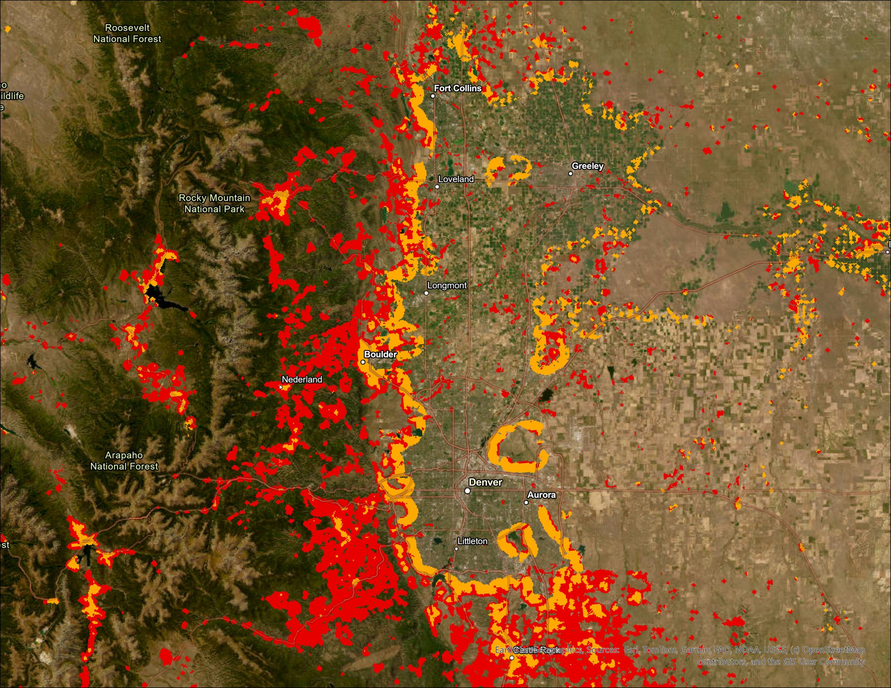

https://doi.org/10.5281/zenodo.23404697   

# WUI Mapping Tool

A Python tool for mapping the Wildland-Urban Interface (WUI) anywhere in the contiguous United States. It combines building density from [HISDAC-US](https://doi.org/10.7910/DVN/U2P66Z) historical built-up property records with vegetation from the [National Land Cover Database (NLCD)](https://www.mrlc.gov/), and classifies WUI intermix and interface zones following the Radeloff/SILVIS methodology. Results can optionally be validated against [SILVIS Lab](https://silvis.forest.wisc.edu/data/wui-change/) WUI maps.

The initial tool was developed by Max Warnock, Quin Browder, and Victoria Madden for GEOG 4303 at CU Boulder (Spring 2025). See the [project paper](docs/wui_mapping_paper.pdf) for methods and results as of May 2025. Max has since added additional features and improvements, such as automatic downloads for anywhere in the country, and fixes for some of the WUI mapping calculations and SILVIS map comparisons. 



*WUI map of Colorado's Northern Front Range, from Fort Collins to Castle Rock. Intermix (red) is housing mixed into wildland vegetation; interface (orange) is housing next to large vegetated areas.*

## Features

- **Automated data download** for any state and year: NLCD land cover, HISDAC-US built-up property locations (BUPL), and optionally SILVIS Lab WUI maps.
- **Customizable WUI criteria**: moving-window radius, housing-density threshold, vegetation thresholds, and buffer distance, with standard values suggested at each prompt.
- **Intermix and interface classification** using circular moving windows.
- **Optional vegetation classes**: splits the WUI map by forest and shrubland cover.
- **Validation against SILVIS Lab maps**: accuracy, precision, recall, F1, and a confusion matrix.
- **ArcGIS Pro layer files** (`.lyrx`) for consistent map symbology.

## How it works

1. **Prepare inputs.** NLCD is reprojected and resampled to the BUPL grid (~250 m), and BUPL is clipped to the NLCD study area.
2. **Moving windows.** A circular moving window computes the share of wildland vegetation (NLCD forest, shrubland, grassland, and wetland classes; agriculture is excluded, as in SILVIS) and the building density around each cell.
3. **Housing density.** Cells below the minimum density (standard: 6.17 buildings/km², about 1 housing unit per 40 acres) are excluded.
4. **Intermix.** Cells with at least the threshold share of wildland vegetation (standard: 50%) are classified as intermix.
5. **Interface.** Cells with less vegetation that fall within a buffer (standard: 2.4 km) of large, dense vegetation patches (standard: at least 5 km² with at least 75% vegetation) are classified as interface.

## Requirements

- **ArcGIS Pro** with the **Spatial Analyst** extension, for `arcpy`.
- **scikit-learn** in the ArcGIS Pro Python environment, for the SILVIS comparison statistics.
- A separate conda environment with `geopandas`, `rasterio`, and `requests`, for the data download script ([environment.yml](environment.yml)). These are kept separate because they can conflict with the package versions ArcGIS Pro relies on.

## Installation

```bash
git clone https://github.com/maxwarnock/wui_mapping.git
cd wui_mapping
```

**1. ArcGIS Pro environment** (runs the mapping tool). ArcGIS Pro's default environment can't be modified, so clone it first. Do this in ArcGIS Pro under *Settings → Package Manager*, or from the *Python Command Prompt*:

```bash
conda create --clone arcgispro-py3 --name wui_mapping
activate wui_mapping
conda install scikit-learn
```

**2. Download environment** (runs `download_data.py`):

```bash
conda env create -f environment.yml
```

## Usage

### 1. Download data

Using the `wui_data_download` environment:

```bash
python download_data.py --state CO --year 2020 --silvis
```

This saves `data/nlcd_CO_2019.tif`, `data/BUPL_CO_2020.tif`, and, with `--silvis`, the SILVIS Lab WUI map for Colorado in `silvis_data/`. NLCD is published only for certain years (2001, 2004, 2006, 2008, 2011, 2013, 2016, 2019, and 2021), so the closest available year is used. Run it without arguments to be prompted for the state and year instead.

| Option | Description |
|---|---|
| `--state` | State name or two-letter abbreviation |
| `--year` | Year to download |
| `--resolution` | NLCD resolution in meters (default: 90). Use 30 only for small states, since a whole state at 30 m can run out of memory. |
| `--silvis` | Also download the state's SILVIS Lab WUI map for validation. Off by default because the files are large (about 170 MB for Colorado and 400 MB for California). |
| `--skip-nlcd`, `--skip-bupl` | Skip downloading NLCD or BUPL, for example to fetch only the SILVIS map |

### 2. Run the mapping tool

Using the `wui_mapping` (ArcGIS Pro) environment:

```bash
python wui_mapping_tool.py
```

The tool uses the most recently downloaded `nlcd_*.tif` and `BUPL_*.tif` in `data/`, then asks a series of questions. Press Enter at a prompt to use the standard value.

| # | Question | Standard value | Affects |
|---|---|---|---|
| 1 | Also produce a WUI map split by vegetation class? | — | Extra output |
| 2 | Moving-window radius (1 = 250 m) | 2 | Intermix and interface |
| 3 | Minimum building density (buildings/km²) | 6.17 | Intermix and interface |
| 4 | Minimum wildland vegetation share for intermix (%) | 50 | Intermix |
| 5 | Minimum size of a "large vegetation area" (km²) | 5 | Interface |
| 6 | Minimum vegetation cover within large vegetation areas (%) | 75 | Interface |
| 7 | Buffer distance around large vegetation areas (km) | 2.4 | Interface |
| 8 | Compare the result to a SILVIS Lab WUI map? | — | Validation |
| 9 | Recompute statistics and a confusion matrix with scikit-learn? | — | Validation |

To use specific files instead of the most recent downloads, set these environment variables:

| Variable | Purpose |
|---|---|
| `WUI_NLCD_PATH` | Path to a specific NLCD raster |
| `WUI_BUPL_PATH` | Path to a specific BUPL raster |
| `WUI_SILVIS_PATH` | Path to a specific SILVIS shapefile |
| `WUI_MAPPING_WORKSPACE` | Workspace folder (default: the repository folder) |

### 3. View the results

Outputs are saved to `results/`, tagged with the state and year of the input data:

- `wui_<STATE>_<YEAR>.tif`: the WUI map (intermix and interface).
- `wui_veg_<STATE>_<YEAR>.tif`: the WUI map by vegetation class, if you answered yes to question 1.

Intermediate rasters and shapefiles are saved to `steps/`.

To apply the symbology in ArcGIS Pro, add the raster to a map, open its **Symbology** pane, select the menu (☰) → **Import from layer file**, and choose `wui_symbology.lyrx` (or `wui_veg_symbology.lyrx` for the vegetation map).

## Comparing to SILVIS Lab WUI maps

Answer yes to question 8 to compare your map with the [SILVIS Lab](https://silvis.forest.wisc.edu/data/wui-change/) WUI map for the same state. Download the SILVIS map first with `--silvis` (see above). The tool then finds the file for your state and compares against the SILVIS year (1990, 2000, 2010, or 2020) closest to your input data.

The comparison treats SILVIS as the reference and scores each cell as WUI or non-WUI, reporting accuracy, precision, recall, and F1. Answer yes to question 9 to also see a confusion matrix. Because non-WUI cells usually dominate a study area, precision, recall, and F1 are more informative than overall accuracy.

## Project structure

```
wui_mapping/
├── wui_mapping_tool.py      # Main script: data preparation, WUI classification, prompts
├── wui_mapping_module.py    # Moving windows, vegetation mapping, SILVIS comparison
├── download_data.py         # Downloads NLCD, HISDAC-US BUPL, and SILVIS data for a state
├── environment.yml          # Conda environment for download_data.py
├── wui_symbology.lyrx       # ArcGIS Pro symbology for the WUI map
├── wui_veg_symbology.lyrx   # ArcGIS Pro symbology for the vegetation WUI map
├── docs/                    # Project paper and README images
├── data/                    # Input rasters (created by download_data.py)
├── silvis_data/             # SILVIS Lab shapefiles (created by download_data.py --silvis)
├── steps/                   # Intermediate outputs (created on run)
└── results/                 # Final WUI maps (created on run)
```

## Data sources

- **NLCD:** U.S. Geological Survey, [Multi-Resolution Land Characteristics Consortium](https://www.mrlc.gov/).
- **HISDAC-US BUPL:** Uhl, J. H., and Leyk, S. *Historical Settlement Data Compilation for the United States*, Harvard Dataverse. https://doi.org/10.7910/DVN/U2P66Z
- **SILVIS Lab WUI maps:** University of Wisconsin–Madison SILVIS Lab. https://silvis.forest.wisc.edu/data/wui-change/
- **State boundaries:** U.S. Census Bureau TIGER/Line.

## References

- Bar-Massada, A., Stewart, S. I., Hammer, R. B., Mockrin, M. H., and Radeloff, V. C. (2013). Using structure locations as a basis for mapping the wildland urban interface. *Journal of Environmental Management*, 128, 540–547. https://www.fs.usda.gov/rm/pubs_other/rmrs_2013_bar_masada_a001.pdf
- Radeloff, V. C., Helmers, D. P., Kramer, H. A., et al. (2018). Rapid growth of the US wildland-urban interface raises wildfire risk. *Proceedings of the National Academy of Sciences*, 115(13), 3314–3319. https://doi.org/10.1073/pnas.1718850115

## License

This project is licensed under the [MIT License](LICENSE.md).
